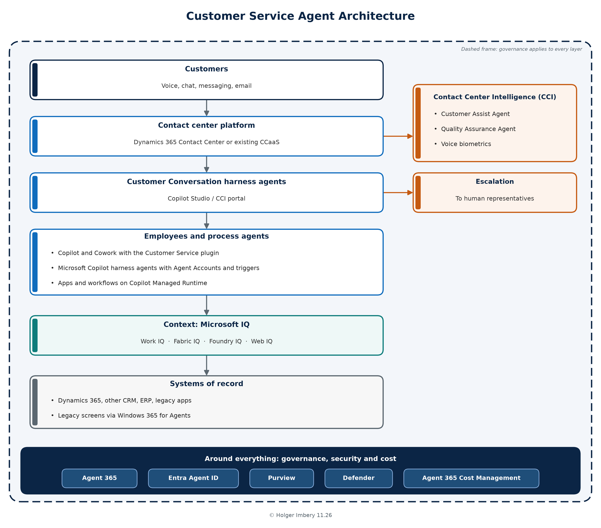

{: .q-left }
> Ignite 2026 ran from November 17 to 20 in San Francisco and online, and the Book of News was long again. Most of it was about Azure, Foundry, security, and Windows, and very little of it mentioned customer service by name. Still, when I read it with my customer service and process glasses on, a lot of it changes how I would design a service organization today. Now that the event is over, this article is my review of the week. I wrote it for the people who decide where the money goes and for the people who build what was decided. After this Ignite, those two groups need to talk to each other more than before.

## Key announcements and their status

These are the announcements I think matter for customer service and process work, along with the status Microsoft provided.

| Announcement | Status after Ignite | Why I care |
|---|---|---|
| Microsoft Contact Center Intelligence (CCI) | Generally available | Microsoft AI on top of the contact center you already run |
| Customer Conversation harness in Copilot Studio | Generally available (preview since October) | A builder made for customer-facing voice and chat agents |
| Microsoft Copilot harness in Copilot Studio | Generally available | The natural home for longer process agents |
| Dynamics 365 Customer Service plugin in Copilot | Generally available | Case work can happen in Copilot, with a review step |
| Microsoft IQ | Generally available, some parts preview | The shared context your agents will read from |
| Business Applications in Work IQ | Generally available, Cowork access in preview | Dynamics 365 case data as shared context for Copilot and agents |
| Agent Accounts, memory, and triggers | Agent Accounts public preview in December 2026 | Agents that own a step in a process |
| Copilot Managed Runtime | Generally available | One place to host and govern apps, agents, and workflows |
| Windows 365 for Agents | Partly available, several parts preview | A way to automate old screens with no API |
| Microsoft-Decision-1.1 | Generally available | A small, cheap model for routing and classification |
| Foundry multi-turn evaluation and Agent Optimizer | Generally available, human annotation in preview | Measuring and improving customer-facing agents after go-live |
| Agent 365 Cost Management and Business Analytics | Preview and Frontier | Control over usage-based AI cost |
| Dynamics 365 Activate | CRM generally available, ERP private preview | Help with moving off Salesforce or SAP ECC |

In short, the question is no longer whether we can build a good service agent on Microsoft technology. The questions now are which runtime it should use, what it can know, whose identity it acts under, and who pays for it.

## The week at a glance

Most of the news came out on the first two days. This is how the week looked from a customer service point of view.

| Day | Date | What Microsoft announced for service and process work |
|---|---|---|
| Day 1 | November 17 | Keynote and Book of News. Dynamics 365 in Copilot with the Customer Service plugin, Microsoft IQ, the Microsoft Copilot harness, Microsoft-Decision-1.1, and Agent 365 Cost Management. Teper's post named CCI as generally available. |
| Day 2 | November 18 | The full CCI general availability announcement with Avaya, Cisco, and Five9. Jason Moore's Copilot Studio post with the Customer Conversation harness. Business Applications in Work IQ generally available. |
| Day 3 | November 19 | Dynamics 365 Activate, with CRM migration generally available and ERP in private preview, and a post on Dynamics 365 ERP data and business skills in Work IQ. |
| Day 4 | November 20 | No further first-party announcements for customer service. |

Most of what matters for service was known by Wednesday. The last two days filled in ERP and migration details, which matter for service mostly through the shared data underneath.

## Copilot, Microsoft IQ, and Agent 365 around Dynamics 365

Jeff Teper's Ignite post for Dynamics 365 explains the thinking better than the Book of News does. He says business applications now need three things: an intelligent user experience, context, and governance. His phrase for the first is that "Copilot is the front door to your business, and plugins teach it how you work." Microsoft IQ supplies the context, Agent 365 supplies the control, and Dynamics 365 sits underneath as what Microsoft now calls the "agentic system of record".

For contact centers, this is a familiar structure. We always had channels, an interaction layer, knowledge, a system of record, and some kind of oversight. What changed is that every one of those layers now has AI in it that can take actions as well as make suggestions.

I like the direction. A service representative who can read a case history and draft a reply in Teams or Copilot doesn't need to jump between three applications. What I keep an eye on is the system of record. When an agent changes a case outside Dynamics 365, the business rules, audit trail, and permissions still have to apply. Microsoft says they do, through review checkpoints and existing permissions, and that is the first thing I would want to see working in a real tenant.

## Microsoft Contact Center Intelligence

Microsoft introduced Contact Center Intelligence in public preview on October 21, 2026. At Ignite, Teper wrote that it "is now generally available", and on November 18 Omar Aftab followed with a full general availability announcement.

The idea is simple. Microsoft took the AI built into Dynamics 365 Contact Center and made it work with other contact center platforms through what the October post called "an open connector". You keep your telephony, routing, and agent desktop. You add Microsoft's agents, quality management, and analytics on top.

The Microsoft Learn "What's new" page, updated November 17, 2026, lists four generally available areas. The first is integration with supported CCaaS platforms, with initial guidance for Genesys Cloud and a universal connector for others. The others are quality and operational insights, voice biometric authentication, and the reuse of Copilot Studio agents with extension through Foundry. The October launch also mentioned a Service Operations Agent as "coming soon". It does not appear in the November list, so I would not count on it yet. Microsoft published no further CCI news after November 18, and the [What's new page](https://learn.microsoft.com/en-us/contact-center-intelligence/implement/whats-new-contact-center-intelligence) still shows the same November list.

The November 18 announcement adds several points that matter for planning:

* **Partnerships with Avaya, Cisco, and Five9.** Microsoft says it is working directly with these vendors "to build and maintain out-of-the-box connectors". The open connector stays available for every other platform.
* **Handoff to people.** Agents handle self-service on your existing voice and digital channels and then hand off to representatives who keep working in the desktop they know. According to Microsoft, context and voice authentication carry over when a call moves to a representative.
* **A new speech model.** CCI will offer Microsoft AI Realtime 1, a speech-to-speech model, and Microsoft says its own labs built smaller models tuned for service work such as quality assurance.
* **Governance from the first minute.** Every agent built in CCI appears in the Agent 365 registry as soon as a maker names it, before it is published.
* **A path to Dynamics 365 Contact Center.** Microsoft describes the later move from CCI to Dynamics 365 Contact Center as a "seamless upgrade".

Until now, when a customer asked me how to get Microsoft's contact center AI, the honest answer was usually "move to Dynamics 365 Contact Center". For an organization in the middle of a long contract with another vendor, that answer ended the conversation. Now the AI layer and the contact center platform are two separate decisions. Teper says it plainly: many organizations "don't have time to replace their existing contact center infrastructure". The vendor partnerships make this more concrete. If you run Avaya, Cisco, or Five9, you can expect a maintained connector instead of building the integration yourself.

It also adds a new integration point to the architecture. Between your CCaaS platform and CCI you now pass live audio or messages, events, customer context, and handoffs to people. I would want clear answers to four questions. What does your platform actually expose to the connector? Does the handoff keep its context in your setup, so the customer does not have to start over? Where are recordings, transcripts, and voiceprints stored? And which system has the final word on quality scores when both your vendor and CCI can evaluate a conversation?

{: .important }
Voice biometrics is now part of a generally available offer. Biometric data used to identify a person is special category data under GDPR. Bring your data protection officer in before the first pilot, not after it.

## Customer Conversation harness in Copilot Studio

Every agent in Copilot Studio runs on a harness. Microsoft Learn describes the harness as the runtime between your agent design and the model. It decides when the model is called, what context it gets, and which tools it uses.

The Customer Conversation harness went into public preview in October, and Jason Moore's Copilot Studio post from November 18 says it is now generally available. Omar Aftab described it as "a purpose-built harness and builder specifically designed to create powerful conversational agents for customer engagement". What makes it interesting for service is the way it is put together. One agent handles both voice and chat, so a customer can move from the website to the phone without losing context. The agent can be a team of specialist sub-agents, each with its own knowledge and tools. In October Microsoft said each sub-agent would be able to use its own model at general availability. The November 18 CCI announcement now lists this as "coming soon", so it did not arrive with general availability. Pro-code agents built in Foundry can join that team, and Microsoft IQ is available to all of them.

The part I like most is that generative and scripted behavior live side by side. A skill can be left to the model, or it can follow a fixed topic step by step. In a regulated contact center that is exactly what you need. You let the model handle the open "my bill looks wrong" conversation, and you script the identity check and the payment word for word.

Two practical notes from Microsoft Learn. You can start building in Copilot Studio or in the CCI portal, but only the portal connects the agent to a live contact center. And agents on this harness are billed in Copilot Credits.

In my view, this is the first time Microsoft treats the customer conversation as its own design problem instead of a variation of an internal assistant. With general availability, it is ready for production pilots. I would still keep the first rollout narrow. Per-agent model choice is not there yet, and it will change the cost picture once it arrives.

## The three harnesses in Copilot Studio

Copilot Studio now offers three harnesses. The Microsoft Copilot harness is the one many of us knew as the GitHub Copilot harness. Microsoft renamed it on October 28, 2026, and said existing agents keep working with no change to capabilities or billing. At Ignite, Teper listed it as generally available.

This is roughly how I explain the choice in customer workshops:

| Question | Standard harness | Microsoft Copilot harness | Customer Conversation harness |
|---|---|---|---|
| Who talks to the agent | Employees or customers | Mostly employees and processes | Customers |
| How behavior is defined | Topics, triggers, branches | Instructions, skills, tools | Sub-agents with skills and topics |
| Best for | Predictable, rule-based flows | Long, multi-step process work | Voice and chat service with human escalation |
| Example | Internal help desk | Accounts payable exceptions | Billing hotline with a payment step |
| Billing | Included with some licenses, or consumption | Copilot Credits | Copilot Credits |

Microsoft published numbers comparing the Microsoft Copilot harness with the standard one. In Teper's post, multitool performance rose from 87.0% to 98.9% and input tokens per task fell by 45%. The renaming post reports pass rates 10.8 percentage points higher with an OpenAI model and 22.1 points higher with an Anthropic model. These come from Microsoft's own evaluations. I take them as a sign of direction, not as a promise for your process. A customer example from Jason Moore's November 18 post is more useful to me: by adding a Copilot Studio agent to its finance automation, Asurion raised touchless invoice processing from less than 20% to more than 70%.

The same post has an example that is even closer to service work. Microsoft's own support team built a "dynamic resolution agent" for complex support cases. In August 2026 it resolved more than 35% of cases with no human involvement. I find this number useful because it is honest about the split. Even a strong agent left most cases to people, so the handoff and the representative's tools still decide most of the customer experience.

There is also a preview that upgrades a standard agent to the Microsoft Copilot harness. It carries over instructions, tools, and prompts, rebuilds topics as skills or workflows, and gives you a report of what moved and what did not. Useful, but try it on a few agents before you trust it with a whole estate.

{: .caution }
Upgrading from the standard harness to the Microsoft Copilot harness can move an agent from license-included use to usage-based billing. Make that cost decision before the technical one.

## Dynamics 365 Customer Service plugin in Copilot

The case form is no longer the only place where case work happens. Microsoft announced Dynamics 365 in Copilot, and the Customer Service plugin is generally available.

Jared Spataro's post mentions 13 service skills. Copilot can triage cases, gather case history, look up answers in knowledge, draft replies, and prepare escalation summaries, "with case updates held for review before anything is committed". Agents built on top can go further and create, update, follow up on, and close cases, turn solved cases into knowledge, and rate interaction quality.

The Microsoft Learn article on using these skills in Cowork fills in what an architect needs to know. Representatives approve proposed field updates through checkpoints before anything is written to Dynamics 365. Everything runs inside the permissions the user already has. Teams can add their own skills for their workflows, knowledge sources, and triage rules. And to get started you need Cowork access under your licensing and spending policy, Customer Service licensing, the Service app, and the Customer Service MCP configuration.

The same Customer Service MCP tools are also reachable through Business Applications in Work IQ, which became generally available on November 18. So the plugin is not the only way into your case data. Agents built in Copilot Studio can use it too, within the same permissions.

From the business side, this helps with the work that happens around a conversation: preparing a callback, writing up an escalation, finding cases that have waited too long for a customer reply. That work rarely shows up in contact center metrics, but it costs real time. From the technical side, two things become new parts of your solution. The Service app and its MCP setup need the same change control as any integration. And your triage and escalation rules, once written as skills, need an owner and a review rhythm just like your knowledge articles.

## Agent Accounts, memory, and triggers

In process digitalization there is often a gap between a person starting a workflow and the system running it on its own. These announcements help close it.

Teper wrote that Agent Accounts enter public preview in December 2026, together with memory and triggers, and Jason Moore confirmed the December date on November 18. The accounts give Copilot Studio agents managed credentials and access to approved resources. An agent with its own account gets a Microsoft Entra ID, a mailbox, and a presence in Teams, according to Microsoft Learn. People can hand it work in a document, by email, or in Teams, and it keeps going. Business process memory, announced in October, means that a detail one colleague explains to the agent becomes shared context for everyone else using it. Triggers start the agent when something happens, such as a new email or a new SharePoint item, and the Book of News adds a Work IQ "listen" capability in preview so agents can react to new messages or business events. Work IQ also gets finer policies and human approval options in preview.

Together, this lets you design a process in which an agent is a named participant. Think of a complaints mailbox owned by an agent. It reads each complaint, opens a case, asks for missing details, and passes the case to a person when the rules say so. Its actions are logged under its own name, not under the maker's account, which is a big step forward for audit.

{: .warning }
An agent with a mailbox and a Teams presence will get mail and messages from real customers and colleagues. Decide what it may answer, what it must pass on, and who looks at what it sends before you give it an address.

## Microsoft IQ

Microsoft IQ is generally available, and the Book of News points out it comes with "no new SKU or subscription". It pulls context from four places:

| Source | What it brings | A service example |
|---|---|---|
| Work IQ | Mail, meetings, chats, files, people, and now Dynamics 365 data | An exception agreed in a Teams thread |
| Fabric IQ | Business data with meaning from semantic models | Customer value or contract status |
| Foundry IQ | Documents, search, and knowledge graphs | Product manuals and warranty terms |
| Web IQ | Public web information with source controls | Public notices about outages |

Teper wrote that Dynamics 365 data is now natively integrated with Work IQ, so people can update customer records in plain language "while respecting existing permissions and governance". On November 18, Julie Koesmarno followed with the general availability of Business Applications in Work IQ. Teams can now use it in production in Copilot Chat, Agent Builder, and Copilot Studio, and developers can reach it through the Work IQ MCP server, API, and CLI. Access through Copilot Cowork is still in public preview.

For service teams, three parts of this release matter most:

* **A semantic model built from your apps.** Work IQ creates a semantic model in Dataverse from the views, forms, and relationships already in your apps. Makers can then add business terms the system cannot work out on its own.
* **Business skills.** A business skill writes down a process as steps that every agent follows. In a service organization, that could be your escalation rule or your goodwill policy.
* **No new access.** Microsoft states that turning on Work IQ "doesn't give any user or agent access they didn't already have". Changes are proposed first, follow any required approvals, and stay within each user's permissions.

Microsoft Learn adds that Dynamics 365 Customer Service is a supported source, through the Customer Service MCP tools. Administrators decide which environments take part with one setting per environment in the Power Platform admin center, and they can hide business data from Copilot in the Microsoft 365 admin center. Dynamics 365 ERP data in Work IQ is in public preview.

This is a big convenience for service teams. A representative can ask Copilot which open cases need attention and get an answer that links back to the source records. For the architect, it means the semantic model and the business skills become shared assets. If they are wrong, every agent that reads them is wrong in the same way, so they need an owner and a review rhythm, just like your knowledge articles.

It also raises a question about sources. The Customer Conversation harness announcement uses the example of a billing dispute where the agent reads a refund policy in SharePoint and an exception agreed in a Teams thread. For an employee assistant, that is great. For an agent that talks to customers, a Teams thread is usually the last place I want it to read from. Somebody has to decide which sources a customer-facing agent may use and which stay internal, and that decision belongs in the design, not in the go-live checklist.

Business plugins in Microsoft IQ, available in the Frontier program, let experts organize guidance for an organization, a business unit, or a project, with inheritance down the structure and sensitivity labels on top. For a service organization with several countries or brands, that inheritance fits nicely: one global complaints policy, with local additions. And the SharePoint indexed knowledge source for Foundry IQ is now generally available and respects source permissions, which is the cleanest way to use SharePoint-based service knowledge in custom agents.

## Copilot Managed Runtime

Copilot Managed Runtime is generally available. It hosts and governs apps built in Copilot Code, Copilot Cowork, Copilot Studio, and compatible third-party tools, and every app shows up in the Microsoft 365 admin center. Teper added that app creation in Copilot Studio is generally available and runs there too. Copilot Code itself is in the Frontier program, with general availability planned for December.

For process teams the more interesting news is the developer story. The first version of Agents and Workflows in Copilot Managed Runtime lets developers build Copilot Studio agents and workflows locally, work on them with their own tools, publish with the CLI, and keep them under version control in GitHub. Apps that need a database or storage can also use Fabric as their backend.

Jason Moore's November 18 post adds more for teams that build together. Agent sharing is generally available, so several makers can work on the same agent in Copilot Studio. Command-line tools and Copilot Studio MCP are in public preview, so developers and their AI assistants can work with Copilot Studio components from their own tools. Business users can also start agents and workflows in natural language from Copilot Cowork or Copilot Code, in public preview, and those agents land in Copilot Studio where IT can govern them.

This helps speed, but it also creates a support risk. The line between "a tracker someone built over lunch" and "a business application" is getting very thin. That is good for speed. It is bad for whoever has to support it two years later. I would set some simple rules early: who may publish, which data backends are allowed, and when an app has to move into a proper solution with an owner.

## Windows 365 for Agents

Most service organizations have at least one old application with important data and no API. Windows 365 for Agents is Microsoft's way of letting agents use those screens.

The Book of News lists several changes. Windows 365 for Agents is now eligible for Copilot Credits, so its cost shows up with your other agent costs. It is available as a computer-use tool in the standard harness in Copilot Studio and will be in preview in the Microsoft Copilot harness in December. Agents on these Cloud PCs will be able to reach on-premises applications with agent identities, in preview, and persistent Cloud PCs for always-on agents are in preview in the Frontier program.

I see this as a bridge. Screen automation is slower than an API and breaks when the screen changes. It is still a good way to remove manual copying today, as long as the same process stays on the list for a proper integration.

## Microsoft-Decision-1.1

A busy contact center makes thousands of small decisions every hour. Which intent is this? Which queue? Is it a complaint? Does it need a supervisor? Sending every one of those to a large reasoning model is slow and expensive.

Microsoft-Decision-1.1 is generally available in Foundry, and the Book of News describes it as built for "routing, classification, prioritization, verification and workflow control". It returns confidence scores, so an application can hand the case to a person or a larger model when it is unsure. Microsoft already uses it to route requests in Copilot and to set reasoning effort in Cowork.

It is not a contact center product, but it fits contact center design well. A small model that makes the quick call, a larger model for the hard cases, and the confidence score as a clear rule for when a human steps in. That is a pattern I want to try for intent detection and case classification. Copilot Studio is moving the same way. According to Jason Moore, the classify node in workflows now uses a decision-scoring model by default, for scenarios like email triage and routing.

## Agent quality and continuous improvement

A customer-facing agent is never finished at go-live. Customers ask new questions, products change, and policies move. Microsoft Foundry got a set of tools for exactly this, and the Book of News describes them as a learning loop.

* **Multi-turn evaluation** is generally available. It scores whole conversations against quality standards, not single answers.
* **Production insights** are generally available. They group recurring failures, such as hallucinations and token spikes, and rank the most frequent ones.
* **Agent Optimizer** is generally available. It proposes changes to an agent, tests them against your evaluations, and lets developers choose what to deploy.
* **Human annotation** is in preview. Experts can add ratings, comments, and expected answers to agent traces and build "golden" datasets.
* **Managed Training** and **Programmed Training** adapt supported models with your own data when changes to the agent are not enough.

These are Foundry features, so they apply most directly to pro-code agents built there, which can join a Customer Conversation harness team. Copilot Studio has its own agent evaluations, including multi-turn conversation tests.

Contact centers have an advantage here. Your quality team already scores conversations with a scorecard. That scorecard is a good first version of your evaluation criteria, and your best quality analysts are the right people for human annotation. I would connect the two worlds early, so the agent is judged by the same standard as your representatives. CCI Quality Assurance then watches live conversations, while the evaluations test changes before they reach customers.

## Governance and security for agents

Agents that talk to customers raise the stakes. They deal with people outside the company, they handle personal data, and some of their actions have legal weight. The security section of the Book of News is long, so I picked what I would take to a service architecture board.

Usage and activity insights for Microsoft pre-built agents and agents built on Microsoft platforms are now generally available in the admin center without an Agent 365 license. Full insights for third-party agents and the security features still need Agent 365 or ME7. Plugins and skills governance is generally available, which is how you control who gets the Customer Service plugin. Governance for MCP servers and tools is in preview, including a view of which plugins break when you block a server. An action center for inactive and ownerless agents is expected in private preview in December. Dynamic Agent Risk, in preview, gives each agent a risk level that moves as the agent acts or gets updated. Entra brings Agent ID to discovered local agents and Autopilot, and an MCP Firewall, both in preview. Purview previews data loss prevention that stops Copilot from using sensitive files even when nobody labeled them.

Overall, agents are now governed much like people. Each one has an identity, an owner, a risk level, and limits. For customer service I would add one rule of my own: every customer-facing agent has a named business owner who signs off on what it does, when it hands over, and what quality it must reach.

## Cost management for usage-based AI

Nearly everything in this article that does real work is billed by usage. The Customer Conversation harness and the Microsoft Copilot harness use Copilot Credits, Windows 365 for Agents is now eligible for them, and even the Today Feed in the Copilot app needs Copilot credits for its updates during the day. Business Applications in Work IQ follows the same split. According to Microsoft, licensed Microsoft 365 Copilot users can ask Copilot Chat about their business data at no extra cost. Agents in Copilot Studio and Cowork, and calls through the Work IQ MCP server and API, are billed by usage.

Microsoft's answer is Agent 365 Cost Management. The Book of News describes a central place to see and control usage-based AI services such as Copilot Cowork, Copilot Studio, Copilot Managed Runtime, and Work IQ APIs, with spending policies, limits, alerts, and chargeback through Fabric. It is in preview. Forecasting and recommendations are in the Frontier program this month, and value insights across Microsoft and non-Microsoft agents follow in December. Agent 365 Business Analytics, also in Frontier, tries to show value through measures such as success rate, user satisfaction, and assisted hours.

Service leaders already know their cost per resolved contact. If AI cost per resolved contact can sit right next to it, the business case discussion gets a lot easier. I go deeper into how licenses and Copilot Credits fit together in [Copilot pricing, licenses, and credits](https://holgerimbery.blog/copilot-pricing-licenses-and-credits), and into the cost governance side in [Agent FinOps in the Microsoft ecosystem](https://holgerimbery.blog/agent-finops-microsoft-ecosystem).

## Dynamics 365 Activate and Salesforce integration

Two announcements are about the systems already in place. Dynamics 365 Activate now offers a generally available Salesforce to Dynamics 365 migration, and for ERP it starts with SAP ECC discovery, requirements analysis, configuration, and data migration in private preview, with project teams reviewing every recommendation. Teper's post quotes a partner saying one large customer is on track to move 20,000 users from Salesforce in about five months. That is a partner's statement, not a benchmark, but it shows where Microsoft wants to compete. Swamy Narayana's Activate post on November 19 adds a point I find important for service. Business Applications in Work IQ can learn your business processes from your Dynamics 365 environment, so "what you carry forward in a migration shapes what Microsoft Copilot and agents understand about your business". In practice, that means old case categories, unused fields, and outdated queues can end up in what your agents learn, so clean them up during the migration.

On the other side, Salesforce in Copilot is in preview with more than 38 prebuilt sales skills. Sales Cloud in Teams is in pilot, and Data Federation between Salesforce Data 360 and Microsoft Fabric is generally available without copying data.

For mixed estates this is good news, because you do not have to pick one CRM to use Copilot as the front door. Be aware, though, that the service skills are clearly strongest on Dynamics 365. If your service runs on Salesforce, check exactly which service skills exist before you plan around them.

## Reference architecture for customer service

This is my own simplified picture of a customer service organization on the Microsoft stack after Ignite. It is not a Microsoft diagram.

The customer side and the employee side now run on different harnesses, but they share one context layer and one set of controls. If they end up reading different knowledge or following different rules, customers will feel it.

## Takeaways after Ignite

Looking back at the whole week, these are the points I take into my next customer workshops.

* **The AI layer and the contact center platform are now separate decisions.** CCI is generally available, with maintained connectors for Avaya, Cisco, and Five9 and an open connector for everyone else.
* **Customer-facing and employee-facing agents run on different harnesses but share one context layer.** Which knowledge a customer-facing agent may read is now a design decision, not a configuration detail.
* **Case work and business data in Copilot are generally available, and so are the review steps.** The Customer Service plugin and Business Applications in Work IQ both propose changes first and stay within existing permissions.
* **Persistent agents and the cost tooling are still on the way.** Agent Accounts arrive in public preview in December, and Agent 365 Cost Management, Business Analytics, and the finer Work IQ policies are in preview or Frontier.
* **Some promised pieces did not arrive.** Per-agent model choice in the Customer Conversation harness is still "coming soon", and the Service Operations Agent was not part of the CCI general availability.

## My recommended next step

My recommendation is to start with one focused piece of work.

Pick a single service journey that has volume, clear rules, and a cost you already measure. Order status, a change of address, or a simple billing question all work. Then use that journey to answer the questions Ignite has raised, with your own data instead of Microsoft's slides.

If you run a contact center platform from another vendor, the journey should go through Contact Center Intelligence on that platform. It is the fastest way to find out whether the connector carries what you need and whether the handoff to your people feels right to a customer. If you already run Dynamics 365, start with the Customer Service plugin for your representatives, because it is generally available and it shows you quickly how well the review checkpoints fit your own approval rules.

While you build, make three decisions properly, because they will shape everything that follows. Decide which knowledge a customer-facing agent may read and which stays internal, and which Dataverse environments take part in Work IQ. Decide who owns the agent on the business side and what it must hand over to a person. And decide how the usage cost is measured and charged, so you can put AI cost per resolved contact next to the number your service leaders already track. Get your data protection officer involved early if voice or biometrics are part of the journey.

The Customer Conversation harness is now generally available, so it can carry that pilot. I would keep the scope narrow until per-agent model choice arrives, because it changes the cost per conversation. Agent Accounts and the cost tooling are still in preview or Frontier, so treat them as things to test, not to build on yet.

In my view, this Ignite was less about one big product and more about the existing pieces working together for customer service. I expect the organizations that get value first to be those that treat knowledge, ownership, and cost as design decisions from the start, rather than those that build the most agents.

## Sources

- Microsoft, [Microsoft Ignite 2026 Book of News](https://news.microsoft.com/events/ignite/2026/book-of-news/), November 17, 2026: event dates; Microsoft IQ general availability and "no new SKU"; Work IQ listen and governance previews; Foundry IQ knowledge graphs and SharePoint indexed knowledge source; Copilot Managed Runtime with Agents and Workflows and Fabric backend; Copilot Code general availability planned for December; Agent 365 Cost Management, Business Analytics, action center, plugins and skills governance, MCP governance, Dynamic Agent Risk, management insights; Entra, Purview previews; Microsoft-Decision-1.1; Windows 365 for Agents; Dynamics 365 Activate; Salesforce in Copilot, Teams, and Fabric; Today Feed and Copilot credits; Foundry continuous improvement with multi-turn evaluation, production insights, Agent Optimizer, human annotation, and Managed and Programmed Training
- Microsoft Dynamics 365 Blog, Jeff Teper, [Microsoft Ignite 2026: Introducing Dynamics 365 in Copilot](https://www.microsoft.com/en-us/dynamics-365/blog/business-leader/2026/11/17/microsoft-ignite-2026-introducing-dynamics-365-in-copilot/), November 17, 2026: the three-part frame of experience, context, and governance; Customer Service plugin general availability; Microsoft Copilot harness general availability and evaluation figures; Agent Accounts public preview in December 2026; CCI general availability; Dynamics 365 integration with Work IQ; Activate figures
- Microsoft Copilot Blog, Jared Spataro, [Copilot at Microsoft Ignite: Expanding what's possible with intelligence built for work](https://www.microsoft.com/en-us/copilot/blog/2026/11/17/copilot-at-microsoft-ignite-expanding-whats-possible-with-intelligence-built-for-work/), November 17, 2026: 13 customer service skills, review before commit, Autopilot identity and named manager, Agent 365 Business Analytics
- Microsoft Learn, [What's new in Microsoft Contact Center Intelligence](https://learn.microsoft.com/en-us/contact-center-intelligence/implement/whats-new-contact-center-intelligence), last updated November 17, 2026: CCI capabilities generally available in November 2026, including Genesys Cloud guidance, universal connector, quality insights, biometric authentication, and Copilot Studio agent reuse
- Microsoft Dynamics 365 Blog, Omar Aftab, [Microsoft Contact Center Intelligence now generally available: Transform customer interactions](https://www.microsoft.com/en-us/dynamics-365/blog/it-professional/2026/11/18/microsoft-contact-center-intelligence-now-generally-available-transform-customer-interactions/), November 18, 2026: CCI general availability; partnerships with Avaya, Cisco, and Five9; Microsoft AI Realtime 1; per-agent model choice "coming soon"; context and voice authentication carried over in handoff; Agent 365 registry on creation; upgrade path to Dynamics 365 Contact Center
- Microsoft Copilot Blog, Jason Moore, [Build and manage business processes with Microsoft Copilot Studio](https://www.microsoft.com/en-us/copilot/blog/copilot-studio/build-and-manage-business-processes-with-microsoft-copilot-studio/), November 18, 2026: Customer Conversation harness general availability; agent accounts public preview in December 2026; Asurion example; Microsoft support team's dynamic resolution agent and its autonomous resolution rate; classify node with decision-scoring model; agent sharing general availability; command-line tools and Copilot Studio MCP preview; agent and workflow creation from Cowork and Code preview
- Microsoft Dynamics 365 Blog, Julie Koesmarno, [Business Applications in Work IQ is now generally available](https://www.microsoft.com/en-us/dynamics-365/blog/it-professional/2026/11/18/business-applications-work-iq-generally-available/), November 18, 2026: general availability in Copilot Chat, Agent Builder, and Copilot Studio; Work IQ MCP server, API, and CLI; semantic models and business skills; no new access; admin controls; included and usage-based billing; Cowork and Dynamics 365 ERP in public preview
- Microsoft Dynamics 365 Blog, Swamy Narayana, [Move beyond legacy ERP and CRM with Dynamics 365 Activate](https://www.microsoft.com/en-us/dynamics-365/blog/it-professional/2026/11/19/dynamics-365-activate-erp-crm-migration/), November 19, 2026: ERP experience in private preview, CRM experience for Salesforce migrations generally available, Work IQ learning business processes from Dynamics 365
- Microsoft Learn, [Business Applications in Work IQ](https://learn.microsoft.com/en-us/power-apps/maker/data-platform/business-applications-work-iq): supported line-of-business data, including Dynamics 365 Customer Service through the Customer Service MCP tools
- Microsoft Learn, [Use Business Applications in Work IQ](https://learn.microsoft.com/en-us/power-apps/user/use-business-apps-work-iq): general availability through Work IQ MCP and Copilot Studio, public preview through Cowork, confirmation before changes
- Microsoft Dynamics 365 Blog, Darya Mazandarany, [Microsoft Contact Center Intelligence: Transforming customer experience at agentic speed](https://www.microsoft.com/en-us/dynamics-365/blog/business-leader/2026/10/21/microsoft-contact-center-intelligence-transforming-customer-experience-at-agentic-speed/), October 21, 2026: CCI public preview launch, open connector, three agents, Service Operations Agent "coming soon"
- Microsoft Community Hub, Omar Aftab, [Introducing the customer conversation harness in Microsoft Copilot Studio](https://techcommunity.microsoft.com/blog/copilot-studio-blog/introducing-the-customer-conversation-harness-in-microsoft-copilot-studio/4563954), October 21, 2026: harness design, sub-agents, generative and deterministic skills, per-agent model at GA, Foundry and Microsoft IQ integration, billing dispute example
- Microsoft Learn, [Harnesses in Copilot Studio](https://learn.microsoft.com/en-us/microsoft-copilot-studio/harnesses-overview): definition of a harness, the three harnesses, Copilot Credits for the Microsoft Copilot and Customer Conversation harnesses
- Microsoft Learn, [What's new in Copilot Studio](https://learn.microsoft.com/en-us/microsoft-copilot-studio/whats-new): October 2026 items, including Customer Conversation harness preview, CCI portal for live contact center connection, harness upgrade preview, agent accounts preview, triggers; multi-turn conversation tests for agent evaluations
- Microsoft Copilot Blog, [The GitHub Copilot harness in Copilot Studio is now the Microsoft Copilot harness](https://www.microsoft.com/en-us/copilot/blog/copilot-studio/the-github-copilot-harness-in-copilot-studio-is-now-the-microsoft-copilot-harness/), October 28, 2026: the rename, no change to billing, evaluation pass rate figures
- Microsoft Copilot Blog, Jason Moore, [Delegate shared business processes to agents that are more persistent and proactive with Microsoft Copilot Studio](https://www.microsoft.com/en-us/copilot/blog/copilot-studio/delegate-shared-business-processes-to-agents-that-are-more-persistent-and-proactive-with-microsoft-copilot-studio/), October 15, 2026: agent accounts, business process memory, triggers
- Microsoft Learn, [Use Dynamics 365 Customer Service skills in Copilot Cowork](https://learn.microsoft.com/en-us/dynamics365/customer-service/use/use-copilot-cowork-service-skills): checkpoints, permissions, custom skills, prerequisites including the Service app and MCP configuration
- Earlier articles on this blog: [Copilot pricing, licenses, and credits](https://holgerimbery.blog/copilot-pricing-licenses-and-credits) and [Agent FinOps in the Microsoft ecosystem](https://holgerimbery.blog/agent-finops-microsoft-ecosystem)
